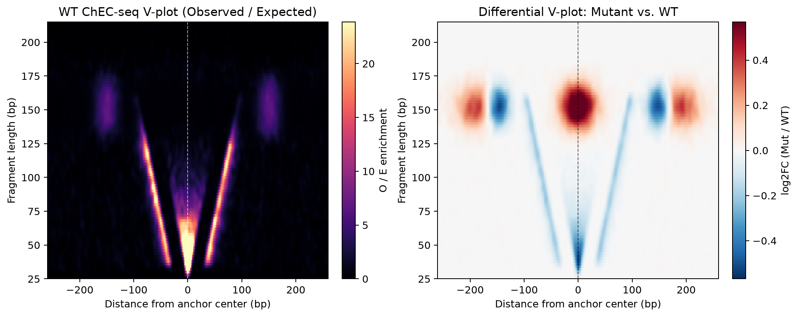

# pyvplot

[](https://github.com/vmindel/pyvplot/actions/workflows/tests.yml)
[](https://vmindel.github.io/pyvplot/)

pyvplot summarises paired-end fragments around a set of genomic anchors (motif hits, TSSs, summits) by position and fragment length. It covers V-plots and differential V-plots, base-resolution cleavage footprints, per-motif protection scores, size-selected heatmap matrices, phasograms and size-selected genome tracks. It has presets for ChEC-seq, ATAC-seq, MNase-seq, CUT&RUN, CUT&Tag and ChIP-exo.



## Install

pyvplot is not on PyPI yet. Install from GitHub:

```bash
pip install "pyvplot[all] @ git+https://github.com/vmindel/pyvplot.git"
```

`[all]` adds Numba (fast kernels), pysam (BAM input), pyarrow (`.parquet` caches) and matplotlib/plotnine/scipy (plots and smoothing). The core needs only NumPy and pandas. See [installation](https://vmindel.github.io/pyvplot/installation/) for the individual extras.

## Example

```python
import pyvplot as vp

# Read the BAM once (single pass) and cache; load() takes well under a second afterwards.
store = vp.FragmentStore.from_bam("chec.bam", assay="chec", min_mapq=20)
store.save("chec.frags.npz")

# Anchors: a BED file (strand in column 6) or a DataFrame with chrom/center/strand.
v = store.vplot("motifs.bed", flank=300, min_len=20, max_len=250, pos_bin=5, len_bin=5)
v.normalize("expected").plot()          # each length row relative to its flank level

# Short-fragment cut sites at 1 bp, split by fragment end, and one score per motif.
fp = store.cut_site_footprint("motifs.bed", flank=100, len_range="tf")
# Near vs far cut of each fragment, keeping only fragments that overlap the BED motif interval.
fp_nf = store.cut_site_footprint("motifs.bed", flank=100, len_range="tf", split_by="proximity", motif_overlap="any")
scores = store.footprint_score("motifs.bed", len_range="tf")

# One heatmap row per motif, strongest first, with the mean profile on top.
store.to_matrix("motifs.bed", flank=500, bin_size=10, feature="midpoint", len_range="tf").plot()

# One locus, unaggregated: every fragment end, labelled near/far from the motif in the window.
store.locus_vplot("chr1:7170-7970", motif="chr1:7560-7580:+", feature="cuts").plot()

# Mutant vs WT, log2 fold change after CPM.
v_ko = vp.FragmentStore.load("ko.frags.npz").vplot("motifs.bed", flank=300, pos_bin=5, len_bin=5)
v_ko.diff(v).plot()
```

No data to hand? `store, anchors = vp.datasets.simulate_chec()` returns a simulated store and anchor table that work with every example in the docs.

## Documentation

- [How pyvplot works](https://vmindel.github.io/pyvplot/concepts/): the six choices every analysis makes (assay shift, anchors, window, feature, length range, normalisation) and the conventions behind them. Read this first.
- [Quick start](https://vmindel.github.io/pyvplot/tutorials/quickstart/) on simulated data, and [your own data](https://vmindel.github.io/pyvplot/tutorials/your-data/): BAM to figures as a script you can submit to a cluster ([`examples/bam_to_vplot.py`](examples/bam_to_vplot.py)).
- Topic tutorials: V-plots and differential V-plots, matrices and footprints, QC and phasing, bias and track export.
- [API reference](https://vmindel.github.io/pyvplot/api/store/).

A Claude Code skill for pyvplot ships with the package: run `pyvplot-install-skills` to install it ([details](https://vmindel.github.io/pyvplot/claude-skill/)).

## Development

```bash
uv venv .venv
uv pip install --python .venv/bin/python -e ".[dev,docs]"
.venv/bin/pytest                      # includes executing every tutorial
.venv/bin/ruff check src tests examples
.venv/bin/mkdocs build --strict
python docs/run_docs.py --update      # refresh printed outputs in tutorials after a behaviour change
```
