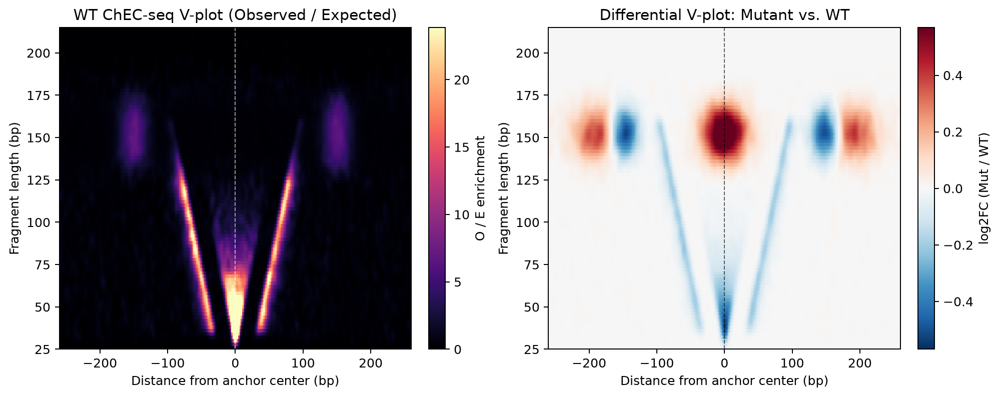

# Plotting

`matplotlib` and `plotnine` renderers for V-plots, differential V-plots, faceted collections, insert-size QC, nucleosome phasograms, and cut-site footprints.

::: pyvplot.plotting.plot_vplot_matplotlib

::: pyvplot.plotting.plot_vplot_plotnine

::: pyvplot.plotting.plot_vplot_collection_plotnine

::: pyvplot.plotting.plot_insert_size_matplotlib

::: pyvplot.plotting.plot_insert_size_plotnine

::: pyvplot.plotting.plot_phasogram_matplotlib

::: pyvplot.plotting.plot_phasogram_plotnine

::: pyvplot.plotting.plot_cut_footprint_matplotlib

::: pyvplot.plotting.plot_cut_footprint_plotnine
