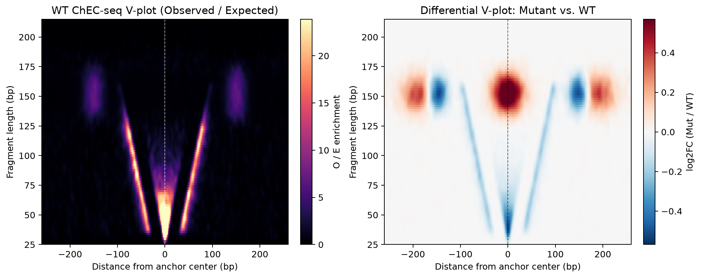

# pyvplot

pyvplot summarises paired-end fragments around genomic anchors (motif hits, TSSs, peak summits) by position and fragment length. It is built for assays where fragment length carries the biology: ChEC-seq and MNase-seq, where TF-protected particles are short and nucleosomes about 150 bp; ATAC-seq; CUT&RUN and CUT&Tag; and ChIP-exo.



## What it does

- **V-plots and differential V-plots**: fragment counts by length and position relative to the anchor, with normalisations that put short TF-sized fragments on the same scale as nucleosomes, and log2 fold change between conditions.
- **Footprints**: base-resolution cleavage profiles split by fragment end, and a per-anchor protection score from centre and flank cut density.
- **Size-selected matrices**: anchors × bins for one fragment class (`len_range="tf"`), for heatmaps and clustering.
- **QC and phasing**: insert-size distribution, size-class fractions, FRiP, phasogram and nucleosome repeat length.
- **Tracks**: size-selected midpoint, cut or coverage tracks to bedGraph, BigWig or a misha database (via `pymisha`).
- **Sequence bias**: k-mer cleavage bias from a naked-DNA control, and correction of 1-bp cut matrices.

## How to read these docs

1. [Installation](installation.md).
2. [How pyvplot works](concepts.md): the six decisions every analysis makes, with the conventions for coordinates, strand, length ranges and normalisation. Most surprising results trace back to one of them.
3. [Quick start](tutorials/quickstart.md) on simulated data (`vp.datasets.simulate_chec()`), then [your own data](tutorials/your-data.md): BAM to figures, including a script for a cluster job.
4. Topic tutorials, then the API reference for argument-level detail.

```python
import pyvplot as vp

store = vp.FragmentStore.from_bam("chec.bam", assay="chec")
store.save("chec.frags.npz")
v = store.vplot("motifs.bed", flank=300, min_len=20, max_len=250, pos_bin=5, len_bin=5)
v.normalize("expected").plot()
```
