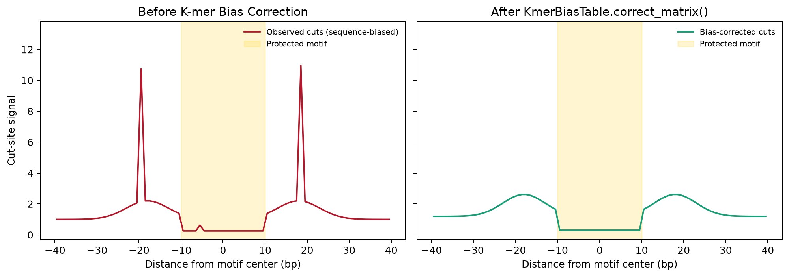

# Cleavage bias and track export

## K-mer cleavage bias

MNase and Tn5 both cut some sequences more readily than others, which can imprint motif-shaped patterns on 1-bp cut profiles. [`KmerBiasTable`](../api/bias.md) estimates relative cut propensity per k-mer from a naked-DNA control store, scaled to mean 1. It can also load a precomputed table (`from_table`, `from_dict`). It can then divide that expectation out of a 1-bp cut matrix.

With real data, pass the genome FASTA directly. Chromosome names must match the store's, and an error is raised if none do:

```py
naked = vp.FragmentStore.load("naked_dna.frags.npz")
bias = vp.KmerBiasTable.from_cuts(naked, "genome.fa", k=6)   # FASTA path (plain or gzipped), pysam.FastaFile, or {chrom: seq}
```

`k=6` has 4,096 k-mers, so it needs millions of control cuts; use `k=4` for shallow controls. The example below uses a toy genome with a planted GATC preference.

```python
import numpy as np
import pyvplot as vp

rng = np.random.default_rng(42)
seq = "".join(rng.choice(list("ACGT"), size=10_000))

starts, ends = [], []
for i in range(50, len(seq) - 200):
    if seq[i : i + 4] == "GATC":
        for _ in range(12):
            starts.append(i + 2)
            ends.append(i + 82)
bg = rng.integers(50, len(seq) - 200, size=500)
starts.extend(bg.tolist())
ends.extend((bg + 80).tolist())

naked_dna = vp.FragmentStore(
    {"chr1": np.asarray(starts, dtype=np.int32)},
    {"chr1": np.asarray(ends, dtype=np.int32)},
    assay="chec",
)
bias = vp.KmerBiasTable.from_cuts(naked_dna, {"chr1": seq}, k=4, cut_offset=2)
print(f"Learned bias at GATC: {bias['GATC']:.2f}x (mean across 4-mers: {bias.weights.mean():.2f}x)")
```

```text
Learned bias at GATC: 54.87x (mean across 4-mers: 1.00x)
```

`correct_matrix` and `correct_footprint` either take pre-extracted 5'→3' sequences per anchor (length `n_bins`, or padded by `cut_offset` bases on the left and `k - 1 - cut_offset` on the right so edge cuts get a full k-mer) **or** extract them directly from a genome FASTA / `{chrom: seq}` dict when you pass `anchors=` (or call `vp.extract_anchor_sequences(anchors, "genome.fa", flank=..., k=bias.k)`). The expectation follows the matrix's `feature`: left-end cuts (`cuts_plus`) are scored on the forward strand, right-end cuts (`cuts_minus`) on the reverse strand, and a combined `cuts` matrix with the mean of the two. This toy example checks that correcting a left-end profile equal to its own expectation flattens it:

```python
anchor_seq = "AAAAAAAA" + "GATC" + "AAAAAAAA"
expected = bias.score_sequence(anchor_seq)
raw_mat = vp.SignalMatrix(
    values=expected[None, :].copy(),
    region_index=np.array(["site_0"]),
    upstream=10,
    downstream=10,
    bin_size=1,
    feature="cuts_plus",
)
corrected = bias.correct_matrix(raw_mat, [anchor_seq], preserve_scale=True)
print(f"Std before correction: {raw_mat.values.std():.3f}, after correction: {corrected.values.std():.6f}")
```

```text
Std before correction: 11.788, after correction: 0.000002
```

Applying `KmerBiasTable.correct_matrix()` around a protected motif removes strong sequence-specific enzyme cleavage spikes while preserving the true underlying TF footprint:



## Genome-wide tracks of one size class

`to_binned_track` bins one feature of one size class genome-wide and returns the non-empty bins as a DataFrame. `to_bedgraph`, `to_bigwig` and `to_pymisha` write the same values. Values are CPM by default (`normalize="cpm"`, over all fragments in the store); `"rpkm"` also divides by bin width in kb, and `None` keeps raw counts. With `feature="coverage"`, each bin gets the covered fraction of its width from each fragment.

```python
track_df = vp.to_binned_track(naked_dna, feature="midpoint", len_range="tf", bin_size=100, normalize="cpm")
bg_path = vp.to_bedgraph(naked_dna, "tf_midpoints.bedGraph.gz", feature="midpoint", len_range="tf", bin_size=100)
print("Exported bins:", len(track_df), "file:", bg_path.name)
```

```text
Exported bins: 98 file: tf_midpoints.bedGraph.gz
```

For BigWig or misha:

```py
vp.to_bigwig(store, "tf_midpoints.bw", chrom_sizes={"chr1": 248_956_422}, feature="midpoint", len_range="tf")
vp.to_pymisha(store, "chec.tf_cuts", feature="cuts", len_range="tf", bin_size=10, mode="sparse")
```

`to_pymisha` calls `pymisha.gtrack_create_sparse(track, description, intervals, values)` or `gtrack_create_dense(..., binsize=, defval=)` on the database you have already initialised. These signatures were checked against pymisha 0.20.1, but the export has not been run against a live misha database in pyvplot's tests.
