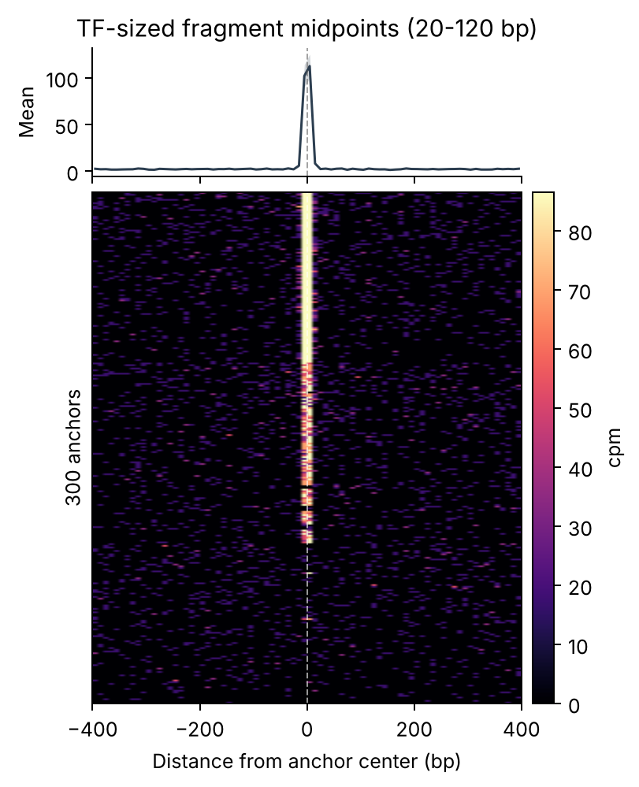
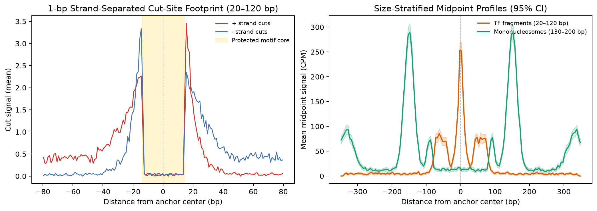

# Matrices and cut-site footprints

A V-plot sums over anchors. The tools on this page keep one row per anchor (`to_matrix`, `footprint_score`) or go to base resolution (`cut_site_footprint`), usually for one fragment size class at a time.

The toy data below has two motifs. At the bound one, `motif_bound`, short fragments span the site with ends 12–25 bp from the centre, so the central ±10 bp is never cut. At the unbound one, `motif_unbound`, cuts are uniform.

## Per-anchor matrices

`to_matrix()` returns a `(n_anchors, n_bins)` [`SignalMatrix`](../api/matrices.md). Choose the fragments with `len_range`: an inclusive `(min_len, max_len)` tuple or a size-bin name such as `"tf"`. Choose what is counted with `feature` (see [features](../concepts.md#4-feature-which-point-of-each-fragment-is-counted)). Pass `feature` explicitly: the default is the assay's, which for ChEC is `cuts`.

```python
import numpy as np
import pandas as pd
import pyvplot as vp

anchors = pd.DataFrame(
    {"chrom": ["chr1", "chr1"], "center": [2000, 6000], "strand": ["+", "-"]},
    index=["motif_bound", "motif_unbound"],
)

starts, ends = [], []
# Bound motif at 2000: cleavage shoulders at +/-12..25 bp, protected center [-10, +10)
for offset in range(12, 26):
    for _ in range(5):
        starts.append(2000 - offset)
        ends.append(2000 + offset)
# Unbound motif at 6000: uniform background cuts
for pos in range(5965, 6035):
    starts.append(pos)
    ends.append(pos + 60)

frags = vp.FragmentStore(
    {"chr1": np.asarray(starts, dtype=np.int32)},
    {"chr1": np.asarray(ends, dtype=np.int32)},
    assay="chec",
)

mat_tf = frags.to_matrix(anchors, flank=100, bin_size=10, feature="midpoint", len_range="tf")
print(mat_tf)
print(mat_tf.region_index.tolist())
```

```text
SignalMatrix(shape=(2, 20), window=[-100, +100) bp, bin_size=10, feature='midpoint', lengths=20-120 bp, normalization='raw', assay='chec')
['motif_bound', 'motif_unbound']
```

Rows follow the input order and labels (`region_index`). `mat.values` is a plain NumPy array. `mat.mean_profile(ci=0.95)` gives the average profile with a normal-approximation interval. `mat.subset(idx)` selects rows, for example after sorting by a score. `mat.to_dataframe()` gives a long table (anchor, pos, value) for ggplot2.

### Heatmaps

`mat.plot()` draws one heatmap row per anchor, with the mean profile and a 95% band on top. By default the rows are ordered strongest first (`order="mean"`). The colour scale runs from 0 to the 99th percentile, so a few very deep anchors don't wash out the rest. Matrices with negative values, such as `row_zscore` or log ratios, switch to a diverging scale centred on 0.

```py
fig, (ax_profile, ax_heatmap) = mat.normalize("cpm").plot()

# Any row order, or a subset of rows, as positions: here strongest footprint first,
# using `scores` from footprint_score() further down this page.
order = np.argsort(-scores["protection_score"].to_numpy())
mat.plot(order=order, title="Sorted by protection score")

mat.plot_plotnine()     # same heatmap as a ggplot object (geom_raster); slow beyond ~1e6 cells
```

Below, 300 simulated sites (100 strongly bound, 100 weakly bound, 100 unbound) sorted by mean:



For other tools, `mat.to_dict()` returns `values`, `region_index`, `upstream`, `downstream` and `bin_size` as NumPy arrays and plain Python values.

## Base-resolution cut-site footprints

`cut_site_footprint()` counts fragment ends at 1 bp. With `split_strands=True` it separates each fragment's upstream end (`plus`) from its downstream end (`minus`), in anchor orientation. For unstranded paired-end data these are fragment ends, not read strands. Fragments that contain a protected site put `plus` ends upstream of it and `minus` ends downstream. Fragments that abut it do the reverse.

```python
fp = frags.cut_site_footprint(anchors.loc[["motif_bound"]], flank=40, bin_size=1, agg="sum")
print(fp)
print("plus ends span", fp.pos[fp.plus > 0].min(), "to", fp.pos[fp.plus > 0].max(), "bp")
print("minus ends span", fp.pos[fp.minus > 0].min(), "to", fp.pos[fp.minus > 0].max(), "bp")
print("cuts within 10 bp of the centre:", fp.combined[np.abs(fp.pos) < 10].sum())
```

```text
CutSiteFootprint(pos=[-39.5, 39.5] bp, n_bins=80, n_anchors=1, split_by='strand', agg='sum', has_matrices=True)
plus ends span -24.5 to -11.5 bp
minus ends span 12.5 to 25.5 bp
cuts within 10 bp of the centre: 0.0
```

`fp.plot()` draws both strands; `fp.to_dataframe()` gives a long table (pos, strand, signal). The figure below shows a strand-split footprint next to TF-sized and nucleosome-sized midpoint profiles (`mean_profile(ci=0.95)` of two matrices with different `len_range`):



## Proximal and distal cuts at motif-overlapping fragments

`split_by="proximity"` splits each fragment's two ends by distance to the anchor centre (`proximal`, `distal`) instead of by orientation. `motif_overlap="any"` keeps only fragments that overlap the motif interval, here the 10 bp around each simulated site. Pass `start`/`end` columns (or a BED file) to give the motif its width.

```python
store, sites = vp.datasets.simulate_chec()
motifs = sites.assign(start=sites["center"] - 5, end=sites["center"] + 5)

fp = store.cut_site_footprint(motifs, flank=80, len_range="tf", split_by="proximity", motif_overlap="any")
print(fp)
for end in ("proximal", "distal"):
    sig = getattr(fp, end)
    print(f"{end}: mean distance {np.sum(np.abs(fp.pos) * sig) / sig.sum():.1f} bp")
```

```text
CutSiteFootprint(pos=[-79.5, 79.5] bp, n_bins=160, n_anchors=50, split_by='proximity', motif_overlap='any', agg='mean', has_matrices=True)
proximal: mean distance 26.5 bp
distal: mean distance 35.2 bp
```

The simulated TF fragments are 45–80 bp and centred on the site with 5 bp jitter, so the near end sits about half a fragment length minus the offset from the centre, and the far end the same plus the offset. `fp.plot()` draws the two ends; `fp.to_dataframe()` has an `end` column instead of `strand`.

For per-fragment analysis, `extract_events` returns `rel_proximal` and `rel_distal` alongside `rel_left`/`rel_right`, and labels each fragment by its overlap with the motif:

```python
ev = store.extract_events(motifs, flank=200, len_range="tf")
print(ev.groupby("motif_overlap", observed=True)[["rel_proximal", "rel_distal"]].agg(lambda x: x.abs().median()))
```

```text
               rel_proximal  rel_distal
motif_overlap
full                   27.0        35.0
partial                 2.0        64.0
none                   80.0       152.0
```

The same two arguments work on `to_matrix` (`feature="cuts_proximal"`) and on `vplot`. A V-plot restricted to overlapping fragments has empty flanks by construction, so normalise it with `"cpm"` rather than `"expected"`.

## Per-anchor protection scores

`footprint_score()` compares cut density in the centre `[-motif_half_width, +motif_half_width)` with the two shoulders of width `flank_width` on either side. `protection_score = log2((flank_density + pc) / (center_density + pc))` is positive when the centre is protected; `accessibility` is the mean density over centre and shoulders. `pc` is in raw cuts per bp; with `normalize="cpm"` it is converted, so the score is the same as on raw counts. Choose `motif_half_width` to cover the expected footprint, not just the motif. The score is per anchor, so with sparse data it is noisy: rank or group anchors with it rather than reading individual values.

```python
scores = frags.footprint_score(anchors, motif_half_width=10, flank_width=25, feature="cuts")
print(scores[["center_cuts", "flank_cuts", "protection_score", "footprint_depth"]].round(2))
```

```text
               center_cuts  flank_cuts  protection_score  footprint_depth
motif_bound            0.0       140.0              5.83             -2.8
motif_unbound         20.0        60.0              0.25             -0.2
```

## De-novo footprints

`footprint_score()` needs the motif positions. To call bound sites without them, from where fragment ends of many lengths pile up, see [De-novo footprints from cut pillars](pillar-scanning.md).
