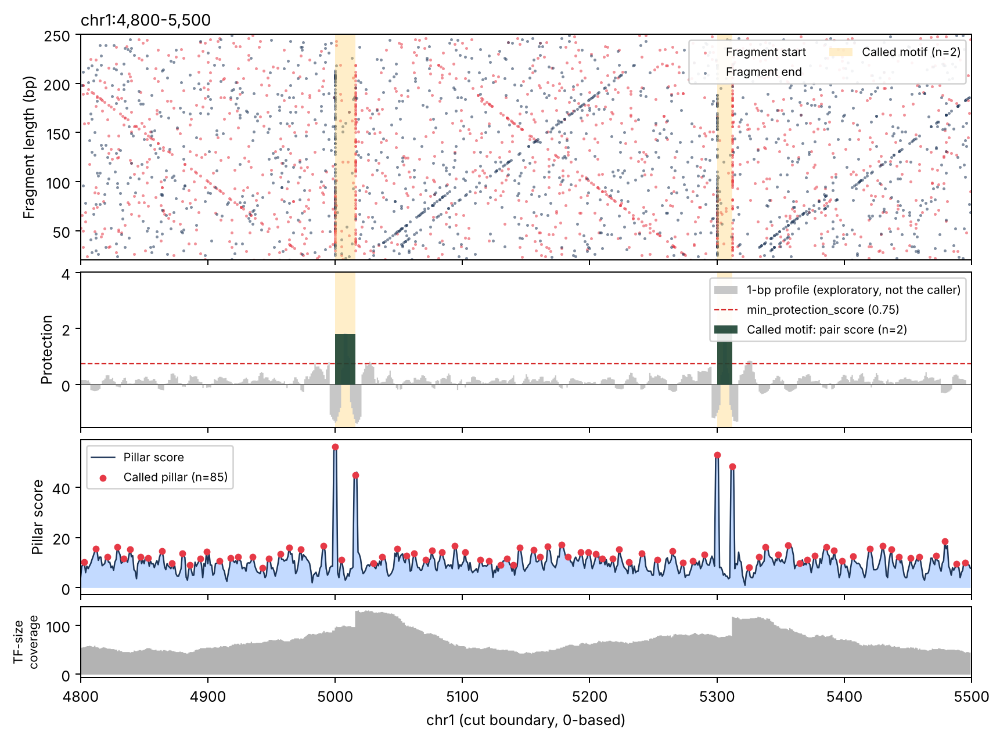

# De-novo footprints from cut pillars

When you do not know where a factor binds, the fragments can still show it. Around a bound protein, fragment ends of many different lengths stop at the same two boundaries, one either side of it, and the DNA between them is not cut. pyvplot calls those boundaries **cut pillars** and calls a **protected motif** between a pair of them. The scanner needs paired-end fragments; stranded stores (ChIP-exo) raise an error.

## Coordinates

Every 1-bp array of a scan is indexed by cut boundary: index `p` is the boundary at genomic `L + p`, between bases `L + p - 1` and `L + p`. A fragment `[s, e)` adds a left cut at `s` and a right cut at `e`. A motif between pillars at `l` and `r` covers the protected bases `[l, r)`, so its `start` is the left pillar and its `end` the right one.

## One locus

The toy store has uniform background fragments over chr1:4000-6000 and two bound sites, `[5000, 5016)` and `[5300, 5312)`: fragments end at the left boundary, start at the right one, and short fragments span each site.

```python
import numpy as np
import pandas as pd
import pyvplot as vp

rng = np.random.default_rng(3)
starts, ends = [], []
for _ in range(3000):  # background
    s = int(rng.integers(4000, 6000))
    starts.append(s)
    ends.append(s + int(rng.integers(20, 250)))
for l, r in [(5000, 5016), (5300, 5312)]:  # bound sites
    for _ in range(80):
        starts.append(l - int(rng.integers(25, 220)))
        ends.append(l)
        starts.append(r)
        ends.append(r + int(rng.integers(25, 220)))
    for _ in range(40):
        starts.append(l)
        ends.append(r + int(rng.integers(20, 80)))
order = np.argsort(starts)
frags = vp.FragmentStore.from_arrays(
    {"chr1": np.asarray(starts)[order].astype(np.int32)},
    {"chr1": np.asarray(ends)[order].astype(np.int32)},
    assay="chec",
)

scan = frags.scan_locus_pillars("chr1:4800-5500")
print(scan)
print(scan.motifs[["start", "end", "width", "protection_score", "raw_log2_protection", "composite_score"]].round(2).to_string(index=False))
```

```text
LocusPillarScan(chr1:4800-5500, n_pillars=85, n_motifs=2)
 start  end  width  protection_score  raw_log2_protection  composite_score
  5000 5016     16              1.81                 2.23            68.36
  5300 5312     12              1.99                 2.55            71.02
```

Both sites come back exactly. Most of the 85 pillars are background stacks that never pair up across a depleted core; the two flanks of the first site stand out by `pillar_score` and by how many length bins they span:

```python
near = scan.pillars[(scan.pillars["pos"] - 5150).abs() < 200]
print(near[["pos", "pillar_score", "n_len_bins", "left_frac", "strand"]].round(2).head(8).to_string(index=False))
```

```text
 pos  pillar_score  n_len_bins  left_frac strand
4957         13.34          11       0.33      -
4964         16.00          15       0.47      -
4973         15.17          13       0.53      +
4991         16.75          15       0.44      -
5000         56.08          22       0.36      -
5005         11.17           9       0.69      +
5016         44.80          19       0.94      +
5030          9.75           8       0.27      -
```

## Looking at a scan

`scan.plot(store=frags)` draws the evidence for every call in four aligned panels:

```python
fig, axes = scan.plot(store=frags)
```



- **Fragment ends by length.** Each fragment contributes its start (red) and end (dark blue). A pillar is a vertical stack: ends of every length stopping at one boundary. Diagonals are fragments sharing their other end.
- **Protection.** Each called motif is a dark bar spanning `[start, end)` at its pair `protection_score`; calls are the bars above the red `min_protection_score` line. The grey 1-bp profile is context only. It dips below zero on the pillars and is not what calls are made from.
- **Pillar score.** Red dots are called pillars. Only pairs of tall pillars with a depleted core between them become motifs, which is why the 81 background pillars produce nothing.
- **TF-size coverage.** Short (20–120 bp) fragments covering each position, which weights the pair score.

Without `store=`, the top panel shows the length-resolved cut matrix instead. `scan.plot(ax=ax)` draws the protection track alone into an existing axis, for multi-track figures; `scan.plot(mode="multiscale")` adds the width-resolved protection profile.

## What the tables hold

`scan.motifs`, one row per called motif:

| column | meaning |
|---|---|
| `start`, `end`, `width` | protected interval `[l, r)` between the two pillars; `width = r - l` |
| `center` | `(l + r) // 2` |
| `raw_log2_protection` | `log2((flank + pseudocount) / (core + pseudocount))`: flank is a weighted geometric mean of the two pillar scores, core the mean of the average and the maximum `pillar_score` strictly inside the pair |
| `protection_score` | `raw_log2_protection` times a 0–1 weight for short-fragment (TF-size) coverage at `center` |
| `left_pillar_score`, `right_pillar_score`, `core_pillar_score` | `pillar_score` at `l`, `r` and `center` |
| `tf_coverage` | short fragments covering `center` |
| `composite_score` | `protection_score * log2(1 + mean flank) * log2(1 + tf_coverage)`; the genome scan sorts by it |

`scan.pillars`, one row per called pillar:

| column | meaning |
|---|---|
| `pos` | the boundary, placed on the centroid of its raw cut stack |
| `start`, `end` | `pos` plus or minus `pillar_window // 2` |
| `pillar_score` | sum over 10-bp length bins of `log2(1 + cuts within pillar_window)` |
| `n_len_bins` | length bins with at least one cut there |
| `left_cuts`, `right_cuts`, `left_frac`, `strand` | fragment starts and ends at the pillar; `strand` is `+` when starts dominate, as on the right flank of a bound site |

`scan.protection_score`, `protection_2d` and `best_widths` are a separate sliding-window profile for plotting and tracks. Motifs are not called from it, so a peak in it need not be a call.

## Thresholds and re-calling

`call()` re-calls pillars and motifs from the stored arrays without touching the fragments:

```python
for thr in (1.0, 1.9, 2.5):
    print(thr, scan.call(min_protection_score=thr).motifs[["start", "end"]].values.tolist())
```

```text
1.0 [[5000, 5016], [5300, 5312]]
1.9 [[5300, 5312]]
2.5 []
```

The thresholds, in the order they act:

- `min_pillar_score` (8.0), `min_len_bins` (4), `min_pillar_prominence` (2.0): what counts as a pillar.
- `motif_width_range` ((10, 24), inclusive): which pillar pairs are scored at all.
- `min_raw_protection` (0.20): minimum `raw_log2_protection` of a pair.
- `min_protection_score` (0.75): minimum after coverage weighting.
- `min_motif_distance` (12): overlapping pairs and centres closer than this keep only the best.

`pillar_score` is a sum of log counts, so the pillar thresholds mean less at higher depth and more at lower depth. Calibrate them on each dataset (below) rather than reusing numbers between libraries.

`scan.to_track_df("protection_score")`, `scan.to_pygenomic_tracks()` and `scan.plot()` export and draw the profiles; `to_track_df("motifs")` and `to_track_df("pillars")` return the tables.

## Genome-wide

`scan_genome_pillars()` finds active windows (50-bp bins with at least `min_bin_frags` short-fragment midpoints, padded and merged) and scans each with the same calling as `scan_locus_pillars`. It returns motifs sorted by `composite_score`, and pillars too with `return_pillars=True`:

```python
motifs, pillars = frags.scan_genome_pillars(return_pillars=True)
print(motifs[["chrom", "start", "end", "width", "composite_score"]].round(1).to_string(index=False))
```

```text
chrom  start  end  width  composite_score
 chr1   5300 5312     12             71.0
 chr1   5000 5016     16             68.4
```

## Sequence bias

MNase prefers AT-rich DNA, so a GC-rich stretch between AT-rich flanks has few cuts with nothing bound. Estimate a k-mer table on a naked-DNA or free-MNase control and pass the expected cut rate:

```python
genome = {"chr1": "".join(rng.choice(list("ACGT"), 10_000))}
# With real data: table = vp.KmerBiasTable.from_cuts(control_store, "genome.fa", k=6)
table = vp.KmerBiasTable(k=4, weights=rng.uniform(0.5, 2.0, 4**4))
expected = vp.pillar_expected_cuts(table, genome)

scan_b = frags.scan_locus_pillars("chr1:4800-5500", expected_cuts=expected)
motifs_b = frags.scan_genome_pillars(expected_cuts=expected)
print(expected("chr1", 5000, 5004).round(2), len(scan_b.motifs), len(motifs_b))
```

```text
[1.18 2.47 2.46 2.44] 2 2
```

`expected(chrom, start, end)` gives, at each boundary, the propensity of a fragment starting there plus that of one ending there. The scanner rescales it to mean 1 per window and divides `pillar_score` by it before scoring pillar pairs; pillars themselves are still called on the uncorrected score. `scan.call()` reuses the scan's correction. On a simulated naked-DNA store with strong 4-mer bias and no bound sites, this cut false motif calls from 58 to 9.

## Calibrating on a control

A free-MNase or naked-DNA control has no footprints, so its calls estimate false positives. Downsample the control to the sample's fragment count first (for example `samtools view -s` on the BAM), scan both permissively, and take the lowest threshold at which the control makes few calls relative to the sample:

```python
rng_c = np.random.default_rng(12)  # control: background only, at the sample's background depth
c_starts = np.sort(rng_c.integers(4000, 6000, 3000))
control = vp.FragmentStore.from_arrays(
    {"chr1": c_starts.astype(np.int32)},
    {"chr1": (c_starts + rng_c.integers(20, 250, 3000)).astype(np.int32)},
    assay="chec",
)
loose = dict(min_protection_score=0.0, min_raw_protection=0.0)
sample_calls = frags.scan_genome_pillars(**loose, min_bin_frags=5)
control_calls = control.scan_genome_pillars(**loose, min_bin_frags=5)
for thr in (0.25, 0.5, 0.75, 1.0, 1.5):
    n_s = int((sample_calls["protection_score"] >= thr).sum())
    n_c = int((control_calls["protection_score"] >= thr).sum())
    print(f"{thr:.2f}  sample {n_s:3d}  control {n_c:3d}")
```

```text
0.25  sample  39  control  34
0.50  sample   6  control   8
0.75  sample   2  control   1
1.00  sample   2  control   0
1.50  sample   2  control   0
```


Below 0.75 the control calls about as much as the sample, so those calls are noise; at the default 0.75 the control still makes one; from 1.0 only the two real sites remain. Here `min_protection_score=1.0` is the choice. The control's count at a threshold divided by the sample's estimates the false discovery rate there. Use the same `expected_cuts` and window settings for both scans.

## Limits

- Closely packed footprints: the stretch between two neighbouring sites is bounded by pillars on both sides. If it is also uncut it is called as a motif of its own. Check widths and motif content before treating every call as a binding site.
- Calls are only as good as the pillars. A bound site with cuts on one side only is not called; `flank_mode="either"` relaxes how the two flanks combine but still needs a called pillar on each side.
- `min_pillar_distance` is 5 bp in both scans; only `call()` changes it.
- Validated so far on simulated data. On real data, check that calls are enriched for the expected motif against matched flanks.
