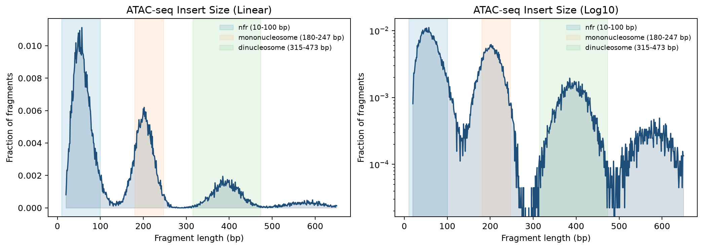
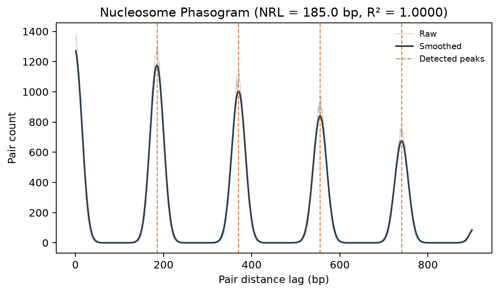

# Fragment QC & nucleosome phasing

## Insert-size distribution, FRiP & `qc_summary`

`qc_summary()` computes fragment-length statistics, assay size-band fractions (from `store.assay.size_bins`), and optional FRiP against peak intervals (automatically merging overlapping peaks to prevent double-counting).

```python
import numpy as np
import pandas as pd
import pyvplot as vp

rng = np.random.default_rng(7)
nfr_lens = rng.integers(40, 80, size=300, dtype=np.int32)
nuc_lens = rng.integers(190, 220, size=200, dtype=np.int32)
lens = np.concatenate([nfr_lens, nuc_lens])
starts = np.arange(1_000, 1_000 + len(lens) * 50, 50, dtype=np.int32)

atac = vp.FragmentStore({"chr1": starts}, {"chr1": starts + lens}, assay="atac")
peaks = pd.DataFrame({"chrom": ["chr1", "chr1"], "start": [1_000, 10_000], "end": [8_500, 18_500]})

summary = atac.qc_summary(peaks=peaks)
print("n_fragments:", summary["n_fragments"])
print("bands:", {k: round(v, 2) for k, v in summary["size_band_fractions"].items()})
print(f"FRiP: {summary['frip']:.2f}")
```

```text
n_fragments: 500
bands: {'nfr': 0.6, 'mononucleosome': 0.4, 'dinucleosome': 0.0}
FRiP: 0.64
```

Plotting an ATAC-seq store with `plot_insert_size_matplotlib(..., show_bands=True)` automatically shades the assay's NFR, mononucleosome, and dinucleosome size regimes on both linear and log10 scales:



## Nucleosome phasogram & NRL estimation

`phasogram()` computes exact pair-distance histograms in `[1, max_lag]` bp via a Numba sliding-window kernel and estimates the **Nucleosome Repeat Length (NRL)** via both harmonic peak-spacing regression (`nrl_peak_fit`, `r_squared`) and FFT periodogram (`nrl_fft`).

```python
rng = np.random.default_rng(2026)
starts_list, ends_list = [], []
for array_idx in range(30):
    base = 5_000 + array_idx * 5_000
    for k in range(8):
        dyad_center = base + k * 185
        for _ in range(10):
            dyad = int(round(dyad_center + rng.normal(0.0, 8.0)))
            fl = int(rng.integers(145, 155))
            starts_list.append(dyad - fl // 2)
            ends_list.append(dyad - fl // 2 + fl)

mnase = vp.FragmentStore(
    {"chr1": np.asarray(starts_list, dtype=np.int32)},
    {"chr1": np.asarray(ends_list, dtype=np.int32)},
    assay="mnase",
)
ph = mnase.phasogram(max_lag=900, smooth_sigma=6.0)
print(f"Estimated NRL: {ph.nrl:.1f} bp (FFT: {ph.nrl_fft:.1f} bp, R^2: {ph.r_squared:.4f})")
```

```text
Estimated NRL: 185.0 bp (FFT: 186.2 bp, R^2: 1.0000)
```

Calling `ph.plot()` overlays the raw pair counts, smoothed phasogram, detected nucleosome harmonics, and estimated NRL:


