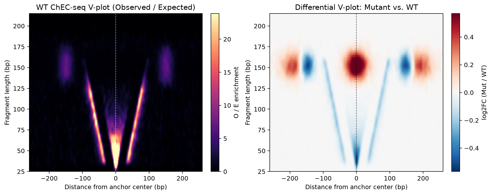

# Quick start

This page runs on simulated ChEC-seq data so every line works without input files. To start from your own BAM, see [your own data](your-data.md). [How pyvplot works](../concepts.md) explains the arguments used here.

## Data

`simulate_chec` places short TF-protected fragments (45–80 bp) on each of 50 binding sites, nucleosome-sized fragments (140–170 bp) within ±400 bp of each site, and background across the chromosome. It returns a `FragmentStore` and an anchor table.

```python
import numpy as np
import pyvplot as vp

store, anchors = vp.datasets.simulate_chec(seed=1)
print(store)
print(anchors.head(3))
```

```text
FragmentStore(n_fragments=10,500, n_chroms=1, assay='chec')
       chrom  center strand
site_0  chr1    1570      +
site_1  chr1    3570      -
site_2  chr1    5570      -
```

With real data the anchors would be a BED file of motif hits, `"motifs.bed"`, passed directly wherever `anchors` appears below.

## V-plot

A V-plot counts fragments by midpoint position relative to each anchor (x) and fragment length (y), summed over anchors. Minus-strand anchors are mirrored, so upstream is always on the left.

```python
v = store.vplot(anchors, flank=250, min_len=20, max_len=200, pos_bin=5, len_bin=5)
print(v)
print("fragments counted:", int(v.counts.sum()))
```

```text
VPlot(pos=[-250, 250) bp step 5, length=[20, 200) bp step 5, shape=(36, 100), n_anchors=50, feature='midpoint', normalization='raw', assay='chec')
fragments counted: 4561
```

`v.counts` is a plain `(n_len, n_pos)` array: row 0 is the shortest length bin and column 0 the most upstream position. `v.len_centers` and `v.pos_centers` label the rows and columns.

## Normalisation

Raw counts are dominated by whatever fragment class is most abundant, usually nucleosomes. `normalize("expected")` divides each length row by its own level in the outer 20% of the window, so 1 means "same as the flanks" at every length:

```python
v_oe = v.normalize("expected")
tf_row = int(np.argmin(np.abs(v_oe.len_centers - 60)))
nuc_row = int(np.argmin(np.abs(v_oe.len_centers - 155)))
centre = int(np.argmin(np.abs(v_oe.pos_centers)))
print(f"60 bp fragments at the site: {v_oe.counts[tf_row, centre]:.0f}x flank")
print(f"155 bp fragments at the site: {v_oe.counts[nuc_row, centre]:.1f}x flank")
```

```text
60 bp fragments at the site: 350x flank
155 bp fragments at the site: 0.5x flank
```

Use `normalize("cpm")` when comparing samples, and `diff()` for mutant vs WT; see [V-plots and differential V-plots](vplots-and-diff.md).

```py
v_oe.plot()                  # matplotlib: returns (fig, ax)
v_oe.plot_plotnine()         # plotnine ggplot object
v.to_dataframe()             # tidy pos / length / value, e.g. for ggplot2 in R
```



## Per-anchor matrix and cut-site footprint

`to_matrix` gives one row per anchor, restricted to one size class. `len_range="tf"` is the ChEC preset's 20–120 bp bin.

```python
mat = store.to_matrix(anchors, flank=250, bin_size=10, feature="midpoint", len_range="tf")
print(mat)
prof = mat.normalize("cpm").mean_profile()
peak = prof.loc[prof["mean"].idxmax()]
print(f"TF-fragment midpoints peak at {peak['pos']:+.0f} bp ({peak['mean']:.0f} CPM per anchor)")
```

```text
SignalMatrix(shape=(50, 50), window=[-250, +250) bp, bin_size=10, feature='midpoint', lengths=20-120 bp, normalization='raw', assay='chec')
TF-fragment midpoints peak at +5 bp (1410 CPM per anchor)
```

`cut_site_footprint` counts fragment ends at 1 bp, split into each fragment's upstream end (`plus`) and downstream end (`minus`) in anchor orientation. The simulated TF fragments contain the site, so their upstream ends fall before it and their downstream ends after it:

```python
fp = store.cut_site_footprint(anchors, flank=60, len_range="tf")
print(fp)
print("plus peaks at", fp.pos[np.argmax(fp.plus)], "bp; minus peaks at", fp.pos[np.argmax(fp.minus)], "bp")
```

```text
CutSiteFootprint(pos=[-59.5, 59.5] bp, n_bins=120, n_anchors=50, split_strands=True, agg='mean', has_matrices=True)
plus peaks at -26.5 bp; minus peaks at 25.5 bp
```

## Save and reload

```python
path = store.save("sim.frags.npz")
same = vp.FragmentStore.load(path)
print(same.n_fragments == store.n_fragments, same.assay.name)
```

```text
True chec
```

## Next

- [How pyvplot works](../concepts.md): every argument above, and the conventions behind them.
- [Your own data](your-data.md): BAM to figures as a cluster script.
