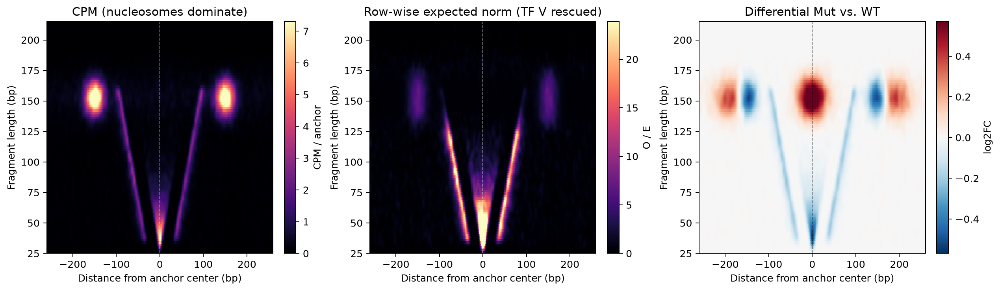
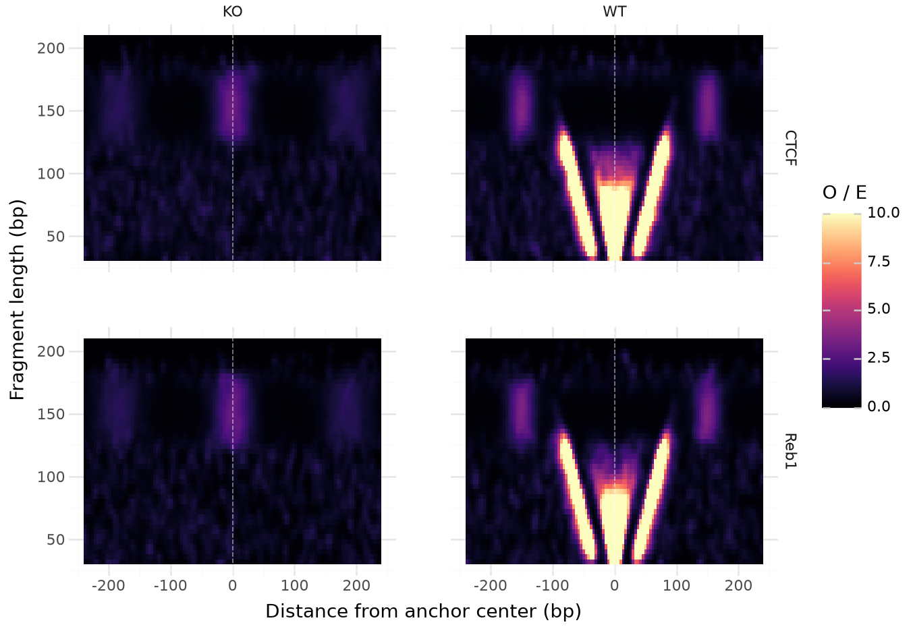

# V-plots and differential V-plots

A V-plot places each fragment by its midpoint relative to the anchor (x) and its length (y), summed over all anchors. Suppose a protein protects `w` bp around the anchor. A fragment of length `L` that contains the protected region can have its midpoint anywhere within `±(L − w) / 2` of the centre. The cloud of protected fragments therefore widens with length, forming a V whose vertex sits at length ≈ `w`. Nucleosomes give a horizontal band near 150 bp, where their positions are fuzzy.

## Two conditions

`simulate_chec` with `tf_fragments=0` gives an unbound condition with the same anchors and nucleosome/background structure.

```python
import numpy as np
import pyvplot as vp

wt, anchors = vp.datasets.simulate_chec(n_sites=100, seed=1)
ko, _ = vp.datasets.simulate_chec(n_sites=100, tf_fragments=0, seed=2)

kw = dict(flank=250, min_len=20, max_len=200, pos_bin=5, len_bin=5)
v_wt = wt.vplot(anchors, **kw)
v_ko = ko.vplot(anchors, **kw)
print(v_wt)
```

```text
VPlot(pos=[-250, 250) bp step 5, length=[20, 200) bp step 5, shape=(36, 100), n_anchors=100, feature='midpoint', normalization='raw', assay='chec')
```

Choosing the axes: `pos_bin` and `len_bin` trade resolution for noise. With a few hundred anchors, 5 bp in both is a reasonable start; with tens of thousands, 1–2 bp works. `max_len - min_len` must be a multiple of `len_bin`, and `2 * flank` a multiple of `pos_bin`.

## Which normalisation

```python
tf_row = int(np.argmin(np.abs(v_wt.len_centers - 60)))
nuc_row = int(np.argmin(np.abs(v_wt.len_centers - 155)))
centre = int(np.argmin(np.abs(v_wt.pos_centers)))

for method in ("cpm", "expected"):
    n = v_wt.normalize(method)
    print(f"{method:9s} TF cell {n.counts[tf_row, centre]:8.3f}   nucleosome cell {n.counts[nuc_row, centre]:8.3f}")
```

```text
cpm       TF cell   62.381   nucleosome cell    3.810
expected  TF cell  523.998   nucleosome cell    0.947
```

In CPM, the colour scale is set by whichever cells are largest. Here that is the TF vertex, because every simulated TF fragment sits within a few bp of the site. In real data TF signal is weaker and more spread out, and the abundant nucleosome band often sets the scale instead. `expected` divides every length row by its own level in the outer 20% of the window (`flank_frac=0.2`), so each row reads as enrichment over its flanks however abundant that length is. The TF vertex and a positioned nucleosome then show up on the same scale.

- `normalize("cpm")`: absolute signal per anchor per million fragments; use when comparing samples.
- `normalize("expected")`: per-row enrichment over the flanks; use to see structure across all lengths. It needs counts in the flanks of every row (pyvplot warns if not).
- `normalize("expected", expected_from="genome")`: per-row expectation from the store's genome-wide length distribution. It corrects for length composition but not for local accessibility, which is useful when the window is too narrow to have true flanks.
- `normalize("log2_oe")`: `expected` on a log2 scale.

## Differential V-plot

`a.diff(b)` gives `a` relative to `b`, so pass the condition of interest first. Raw inputs are CPM-normalised first. The default pseudocount is half a raw count per cell expressed in CPM, one value shared by both samples. The log2FC therefore does not shrink as depth increases, and cells empty in both samples come out as 0.

```python
d = v_ko.diff(v_wt, smooth_sigma=(1.0, 1.0))
print(d)
print(f"KO vs WT at the TF vertex: {d.counts[tf_row, centre]:.2f} log2FC")
print(f"KO vs WT in the nucleosome band: {d.counts[nuc_row, centre]:.2f} log2FC")
```

```text
VPlot(pos=[-250, 250) bp step 5, length=[20, 200) bp step 5, shape=(36, 100), n_anchors=100, feature='midpoint', normalization='diff:log2fc', assay='chec')
KO vs WT at the TF vertex: -7.54 log2FC
KO vs WT in the nucleosome band: 0.09 log2FC
```

`smooth_sigma=(rows, cols)` is a Gaussian blur in bins, applied to each V-plot before the ratio (`smooth_before=False` smooths the ratio instead). Other modes are `"subtract"`, `"ratio"` and `"zscore"`. `d.plot()` uses a diverging colour map centred on 0.

The nucleosome band moves slightly even though it is identical in both simulations. CPM divides by total fragments, and the KO library lacks the TF fragments, so everything else in it is a slightly larger share. Real libraries behave the same way. If TF fragments are a sizeable fraction of one library, compare V-plots normalised to their own flanks as a check. With these inputs the default pseudocount falls back to 0.5, so set one that suits O/E values:

```py
v_ko.normalize("expected").diff(v_wt.normalize("expected"), pseudocount=0.1)
```

## Collapsing to one dimension

```python
prof = v_wt.normalize("cpm").marginal_position(len_range="tf")        # positional profile of 20-120 bp fragments
lens = v_wt.normalize("cpm").marginal_length(pos_range=(-20, 20))     # length distribution at the site
print(f"20-120 bp midpoints peak at {prof.loc[prof['value'].idxmax(), 'pos']:+.1f} bp")
print(f"most common length within 20 bp of the site: {lens.loc[lens['value'].idxmax(), 'length']:.1f} bp")
```

```text
20-120 bp midpoints peak at +2.5 bp
most common length within 20 bp of the site: 67.5 bp
```

## One locus: every fragment, or one motif

The aggregate functions sum over anchors. `locus_vplot` keeps one window unaggregated: each fragment is a point at (position, length). Without a motif it shows the whole window in genomic coordinates; with a motif it is centred on it, and `feature="cuts"` labels each end `proximal` (nearer the motif centre) or `distal`. `cuts_plus` / `cuts_minus` are labelled `upstream` / `downstream` in the motif's 5'→3' orientation, so on a `-` motif the upstream end is the fragment's genomic right end, with `coords="genomic"` too.

```python
site = anchors.iloc[3]
c = int(site["center"])
lv = wt.locus_vplot(
    f"chr1:{c - 400}-{c + 400}",
    motif=f"chr1:{c - 10}-{c + 10}:{site['strand']}",
    feature="cuts",
    len_range="tf",
)
print(lv)
print(lv.points.groupby("end", observed=True)["x"].agg(["size", "median"]).round(1))
```

```text
LocusVPlot(chr1:7170-7970, motif=7560-7580(-), feature='cuts', coords='relative', n_fragments=40, n_points=80)
          size  median
end
proximal    40    -1.0
distal      40    -1.0
```

```py
fig, ax = lv.plot(color_by="end")          # points + shaded motif; color_by="motif_overlap" also works
lv.plot(palette={"proximal": "#e66101"})   # override some level colours; unknown levels raise
lv.to_vplot(pos_bin=5, len_bin=5).plot()   # the same points binned as a V-plot (n_anchors=1)
lv.to_vplot(pos_bin=5, len_bin=5).normalize("expected", expected_from="genome")  # vs the store's length mix
wt.locus_vplot("chr1:7170-7970").plot()    # no motif: midpoints, genomic x axis
```

Regions and motifs are 0-based and half-open (BED), not UCSC's 1-based `chr1:1,001-2,000`. `motif_overlap="any"|"full"|"none"` keeps fragments that touch, contain or miss the motif.

## Several conditions in one figure

`VPlotCollection` stacks labelled V-plots into one tidy table for faceting:

```python
coll = (
    vp.VPlotCollection()
    .add(v_wt.normalize("expected"), condition="WT")
    .add(v_ko.normalize("expected"), condition="KO")
)
tidy = coll.to_dataframe()
print(coll)
print(tidy.columns.tolist(), len(tidy))
```

```text
VPlotCollection(2 V-plots: condition=WT; condition=KO)
['pos', 'length', 'value', 'condition'] 7200
```

```py
coll.plot_plotnine(facet="~ condition")          # plotnine facet_wrap / facet_grid formula
tidy.to_csv("vplots.tsv.gz", sep="\t", index=False)   # or facet in ggplot2
```




